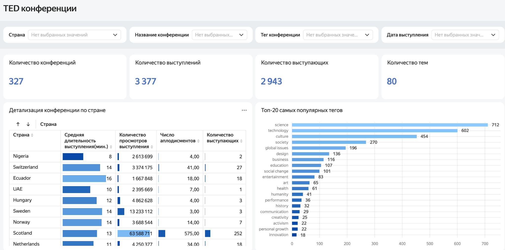
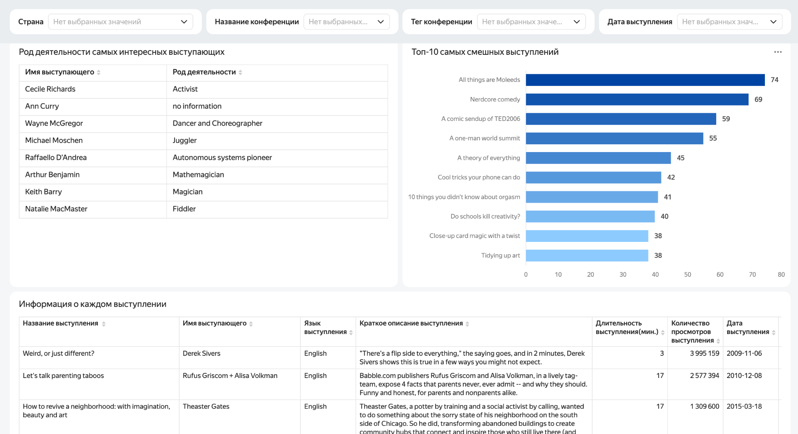

# TED Conferences — интерактивный дашборд

**Yandex DataLens · BI / Data Visualization · Учебный проект**

[**Открыть интерактивный дашборд**](https://datalens.yandex/1azgtg5uxq4ml?_share_link=public)

## Цель

Создать инструмент для исследования конференций TED: оценить масштаб данных, изучить тематику выступлений, реакцию аудитории и характеристики конференций и спикеров.

## Что реализовано

- **Сводные KPI:** 327 конференций, 3 377 выступлений, 2 943 выступающих, 80 тем/тегов.
- **Аналитика по странам:** таблица со средней продолжительностью выступлений, просмотрами, аплодисментами и количеством выступающих.
- **Темы:** рейтинг топ-20 тегов по числу связанных с ними выступлений.
- **Реакция аудитории:** топ-10 выступлений по показателю юмора/смеха; таблица с родом деятельности выделенных спикеров.
- **Детализация:** таблица с названиями выступлений, авторами, языком, описанием, длительностью, просмотрами и датами.
- **Интерактивность:** фильтры по стране, названию конференции, тегу и дате выступления.

## Инструменты

**Yandex DataLens** — разработка дашборда, таблиц, визуализаций и интерактивных фильтров.

> SQL / PostgreSQL в стек этого README не добавлены, потому что способ подготовки исходных данных пока не подтверждён. При наличии собственных SQL-запросов можно разместить их в репозитории и дополнить стек.

## Результаты и наблюдения

- Наиболее часто встречающиеся теги: **science — 712**, **technology — 602**, **culture — 454**. Это частота тегов в данных, **не доказательство предпочтений аудитории**.
- Далее идут **society — 270**, **global issues — 196**, **design — 136**.
- В рейтинге самых смешных выступлений по показателю, отображённому на дашборде, первые позиции занимают **All things are Moleeds — 74**, **Nerdcore comedy — 69**, **A comic sendup of TED2006 — 59**.
- Дашборд позволяет переходить от общих показателей к сравнению стран и отдельным выступлениям, чтобы изучать особенности конференций без ручного поиска по таблицам.

## Скриншоты

### Общая статистика и популярные теги

### Спикеры, юмор и детализация выступлений

## Что показывает проект

Навыки выбора и представления метрик, проектирования BI-дашборда, визуализации сравнений, организации фильтрации и детализации данных для пользователя.

---
*Проект выполнен в рамках обучения по направлению «Аналитик данных» в Яндекс Практикуме.*
